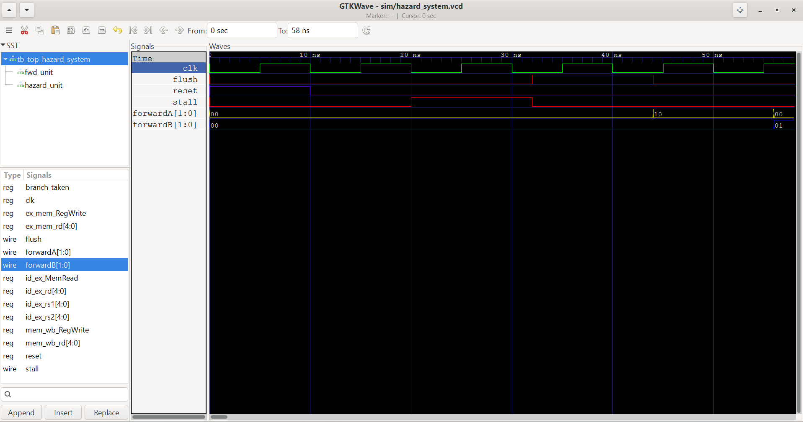

# riscv-hazard-verification
RTL design and verification of hazard detection and forwarding logic for a 5-stage RISC-V pipeline.

## Project Progress
- [x] Day 1: Register Pipeline Stage Implementation
- [x] Day 2: ID/EX Register Unit
- [x] Day 3: Hazard Detection Unit Logic
- [x] Day 4: Forwarding Unit Logic
- [x] Day 5: Hazard Detection Unit Verification
- [x] Day 6: Forwarding Unit Verification
- [x] Day 7: Full System Integration & Simulation Setup
- [x] Day 8: Simulation Execution & Verification
- [x] Day 9: GTKWave Timing Diagram Verification
- [x] Day 10: Final Documentation and Repository clean up

## Hardware Synthesis & SkyWater 130nm Characterization

Target Library: `sky130_fd_sc_hd__tt_025C_1v80` (Typical Corner: 1.8V, 25°C)  
Logic Synthesis Tool: **Yosys Open Synthesis Suite** (integrated ABC technology mapper)  
Simulation Clock: $f = 100\text{ MHz}$ ($T_{\text{clk}} = 10\text{ ns}$)

---

### 1. Forwarding Unit

* **Logic Type:** Pure Combinational Steering Logic (0 Sequential Cells / DFFs)
* **Standard Cell Count:** 34 cells
* **Physical Silicon Footprint:** $252.74\ \mu\text{m}^2$
* **Standard Cell Breakdown:**
  * `sky130_fd_sc_hd__xor2_1` (2-input XOR): 10 cells ($87.58\ \mu\text{m}^2$)
  * `sky130_fd_sc_hd__xnor2_1` (2-input XNOR): 10 cells ($87.58\ \mu\text{m}^2$)
  * `sky130_fd_sc_hd__nand3_1` (3-input NAND): 4 cells ($20.02\ \mu\text{m}^2$)
  * `sky130_fd_sc_hd__nor3_1` (3-input NOR): 4 cells ($20.02\ \mu\text{m}^2$)
  * `sky130_fd_sc_hd__nor4_1` (4-input NOR): 2 cells ($12.51\ \mu\text{m}^2$)
  * `sky130_fd_sc_hd__or4_1` (4-input OR): 2 cells ($15.01\ \mu\text{m}^2$)
  * `sky130_fd_sc_hd__o21ai_0` (And-Or-Invert): 2 cells ($10.01\ \mu\text{m}^2$)

---

### 2. Hazard Detection Unit

* **Logic Type:** Pure Combinational Detection Logic (0 Sequential Cells / DFFs)
* **Standard Cell Count:** 18 cells
* **Physical Silicon Footprint:** $131.38\ \mu\text{m}^2$
* **Standard Cell Breakdown:**
  * Complex AOI/OAI gates (`sky130_fd_sc_hd__a221o_1`, etc.)
  * Clock inverters / buffers (`sky130_fd_sc_hd__clkinv_1`): 4 cells ($15.01\ \mu\text{m}^2$)
  * Multi-input NOR gates (`sky130_fd_sc_hd__nor4_1`): 2 cells ($12.51\ \mu\text{m}^2$)

---

### 3. Subsystem Comparison & Power Metrics

Dynamic switching power was characterized using $P_{\text{dynamic}} = \alpha \cdot C_{\text{load}} \cdot V_{DD}^2 \cdot f$ with an empirical switching factor $\alpha = 0.15$ on active pipeline control cycles, standard average input capacitance per gate pin ($C_{\text{pin}} \approx 4.2\text{ fF}$), and nominal sub-threshold leakage at 25°C.

| Module | Standard Cells | Silicon Area ($\mu\text{m}^2$) | Dynamic Power ($\mu\text{W}$) | Static Leakage ($\mu\text{W}$) | Total Dissipation ($\mu\text{W}$) |
| :--- | :---: | :---: | :---: | :---: | :---: |
| **Forwarding Unit** | 34 | 252.74 | 33.72 | 0.007 | **33.73** |
| **Hazard Detection Unit** | 18 | 131.38 | 17.85 | 0.004 | **17.85** |
| **Total Subsystem** | **52** | **384.12** | **51.57** | **0.011** | **51.58** |